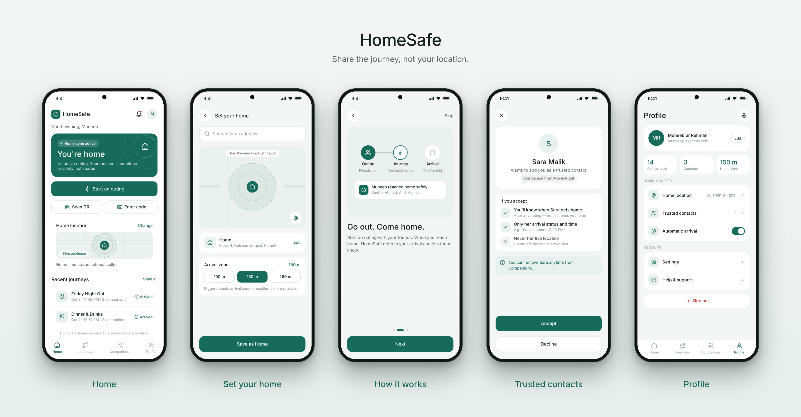

<p align="center"></p>

HomeSafe automatically lets your friends and family know when you've safely reached home after an outing — so nobody has to remember to send the "I'm home" message.

<p align="center">


</p>

## Screens

<p align="center"></p>

## How it works

1. Start an outing
2. Friends join with a QR code or a 4-letter code
3. Go out and forget the app
4. Get home and your friends are notified automatically

## Features

- Automatic arrival detection using geofencing — no constant GPS tracking
- Temporary outing companions, scoped to a single outing
- Trusted contacts, only active after the other person accepts
- Privacy-first: shares arrival status only, never live location
- Works in the background, without opening the app

## Privacy

HomeSafe shares arrival status and time only — for example, "Muneeb reached home at 11:42 PM." No live location, no routes, and no location history are ever shared.

## Tech stack

**In use**
- Kotlin
- Jetpack Compose + Material 3
- Navigation Compose
- Firebase Analytics
- Firebase Crashlytics

**Planned**
- Firebase Auth
- Firestore
- Firebase Cloud Messaging (FCM)
- Cloud Functions
- Geofencing (Google Play Services)
- WorkManager

## Project status

UI phase — screens and navigation are being built. Business logic (location, Firebase, notifications) comes next.

## Roadmap

- [x] Design
- [ ] UI screens
- [ ] Home location + geofence
- [ ] Outings (create/join)
- [ ] Arrival notifications
- [ ] Trusted contacts
- [ ] Expected arrival / late alerts

## Getting started


1. Clone the repo:
   ```
   git clone https://github.com/Muneeb-baloch/Home-Safe-.git
   ```
2. Open the project in Android Studio.
3. Run on a device or emulator (API 24+).

`google-services.json` is already included for Firebase Analytics and Crashlytics. If you connect your own Firebase project later, replace it with your own file from the Firebase console.

## Author

Muneeb ur Rehman
